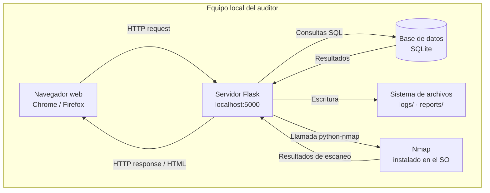

# SecureAudit MX — Documento de Arquitectura

| Campo | Valor |
|---|---|
| **Versión** | 1.2.0 |
| **Fecha** | 2026-10-17 |
| **Autor** | Roberto Pérez |
| **Estado** | En desarrollo |

> **Registro de cambios**
> - **v1.2.0 (2026-10-17)** — Semana 5: scoring (`services/scoring.py`) y dashboard (`GET /resultados`). Chart.js 4.5.1 servido desde `static/js/vendor/chart.umd.min.js`, pytest como dependencia de desarrollo (`requirements-dev.txt`, `pytest.ini`) y ADR-09 con la regla de N/A y «No evaluable». Actualizadas las secciones 1, 3 y 5.
> - **v1.1.0 (2026-09-09)** — Sincronizada con la implementación de la capa de datos: patrón *application factory* (`run.py` + `create_app`), módulo `app/extensions/` con la instancia de SQLAlchemy, los 8 modelos ORM (incluida la tabla puente `sesion_controles`) y el sembrado idempotente desde `seeds/*.json`. Actualizadas las secciones 1, 3 y 5.
> - **v1.0.0 (2026-06-05)** — Versión inicial.

---

## Tabla de contenido

- [1. Stack tecnológico y justificación](#1-stack-tecnológico-y-justificación)
- [2. Diagrama de arquitectura del sistema](#2-diagrama-de-arquitectura-del-sistema)
- [3. Estructura de carpetas del proyecto](#3-estructura-de-carpetas-del-proyecto)
- [4. Flujo principal del usuario](#4-flujo-principal-del-usuario)
- [5. Decisiones de diseño](#5-decisiones-de-diseño)

---

## 1. Stack tecnológico y justificación

SecureAudit MX es una aplicación web local de una sola instancia. Las tecnologías fueron elegidas para maximizar portabilidad, minimizar dependencias de instalación y ser apropiadas para el contexto PyME, donde no existe infraestructura de servidor especializada.

| Capa | Tecnología | Alternativas consideradas | Justificación |
|---|---|---|---|
| Lenguaje | Python 3.10+ | — | Requerimiento del proyecto. Ecosistema maduro para scripting de seguridad (Nmap, análisis de red). |
| Framework web | Flask 3.x | Django | Flask es minimalista y no impone estructura. Para una app de una sola instancia sin ORM complejo, Django añade complejidad innecesaria. Flask permite aprender la arquitectura desde cero. |
| Base de datos | SQLite 3 | PostgreSQL, MySQL | SQLite no requiere servidor ni configuración. Se crea automáticamente en el primer arranque. Suficiente para el volumen de datos esperado (< 500 sesiones, RNF-03.4). |
| ORM / capa de datos | Flask-SQLAlchemy 3.1 (sobre SQLAlchemy 2.0) | SQL crudo con `sqlite3`, Peewee | Flask-SQLAlchemy integra SQLAlchemy con el ciclo de vida de Flask mediante una instancia `db` compartida (`init_app`). SQLAlchemy 2.0 permite modelos tipados con `Mapped`/`mapped_column` y declarar las restricciones (`CHECK`, `UNIQUE`, FK, PK compuesta) en el propio modelo, alineado con `modelo_datos.md`. |
| Migraciones de esquema | Flask-Migrate 4.1 (sobre Alembic) | Recrear la base en cada cambio, Alembic sin integración | Versiona los cambios de esquema en `migrations/` y los aplica sin perder datos; se integra con la app factory (`migrate.init_app`) y los comandos `flask db`. Ver ADR-03. |
| Templates | Jinja2 | React, Vue | Jinja2 está integrado en Flask sin dependencias adicionales. Evita un stack frontend separado y mantiene toda la lógica en Python. |
| CSS / UI | CSS propio con tokens (sin framework) | Bootstrap 5, Tailwind | Sistema de diseño propio: variables CSS (tokens) para color, espacio y tipografía, tema claro/oscuro y componentes con prefijo `sa-`. CSS plano sin compilador ni dependencias, organizado en módulos y servido localmente (RNF-04.4). Ver ADR-08. |
| Gráficas | Chart.js 4.5 | D3.js, Plotly | Chart.js es ligero, bien documentado y suficiente para gráficas de radar y barras. Se sirve localmente desde `static/js/vendor/chart.umd.min.js` (build UMD de la v4.5.1, tomado del paquete de npm con su integridad verificada). |
| Pruebas | pytest 9.1 | unittest (biblioteca estándar) | `assert` simple, *fixtures* y `parametrize` cubren los casos frontera del scoring con poco código. Es dependencia solo de desarrollo (`requirements-dev.txt`); `pytest.ini` agrega la raíz al `sys.path` para importar `app`. |
| Generación PDF | WeasyPrint | ReportLab, fpdf2 | WeasyPrint convierte HTML/CSS a PDF, lo que permite reutilizar los templates de Jinja2 sin duplicar la lógica de presentación. |
| Escaneo de red | python-nmap | scapy, socket nativo | python-nmap es un wrapper maduro sobre Nmap que simplifica el parsing de resultados y es ampliamente usado en herramientas de seguridad. |
| Hashing | bcrypt (flask-bcrypt) | hashlib SHA-256 | bcrypt es el estándar recomendado para contraseñas por su factor de costo ajustable (RNF-01.1). SHA-256 no es adecuado para contraseñas. |
| Autenticación | flask-login | JWT, sesiones manuales | flask-login gestiona el ciclo de vida de sesión de forma segura con mínimo código adicional. Adecuado para apps locales sin API REST. |

---

## 2. Diagrama de arquitectura del sistema

SecureAudit MX sigue una arquitectura de **tres capas** ejecutadas en el mismo equipo local. No existe comunicación con servicios externos durante la ejecución normal.



**Descripción de capas:**

- **Capa de presentación** — el navegador web renderiza las vistas HTML generadas por Jinja2. No ejecuta lógica de negocio; toda la validación ocurre en el servidor.
- **Capa de lógica** — Flask gestiona las rutas, autenticación, lógica de scoring, generación de reportes y coordinación con Nmap. Es el único punto de entrada al sistema.
- **Capa de datos** — SQLite persiste sesiones, respuestas, usuarios y logs. El archivo de base de datos reside en el directorio del proyecto y no es accesible desde fuera del equipo.

---

## 3. Estructura de carpetas del proyecto

Las carpetas marcadas **(pendiente)** forman parte de la arquitectura objetivo pero aún no se implementan; el resto refleja el estado actual del repositorio.

```
secureaudit_mx/
│
├── run.py                      # Punto de entrada: crea la app, inicializa la BD con seed() (RNF-04.5) y corre el servidor
├── seed.py                     # Inicialización idempotente: aplica migraciones y siembra catálogos (y datos demo)
│
├── app/                        # Código fuente de la aplicación
│   ├── __init__.py             # Application factory (create_app) + init de extensiones
│   │
│   ├── extensions/             # Instancias de extensiones Flask (evita imports circulares)
│   │   ├── __init__.py         # Reexporta db
│   │   └── db.py               # Instancia SQLAlchemy (Base declarativa)
│   │
│   ├── models/                 # Modelos ORM (SQLAlchemy 2.0) — un archivo por tabla
│   │   ├── __init__.py         # Importa los 8 modelos (registra el mapper)
│   │   ├── usuario.py
│   │   ├── empresa.py
│   │   ├── sesion.py
│   │   ├── sesionControl.py    # Tabla puente sesiones ↔ controles (PK compuesta)
│   │   ├── control.py
│   │   ├── pregunta.py
│   │   ├── respuesta.py        # Tabla puente sesiones ↔ preguntas (UNIQUE compuesto)
│   │   └── logs.py
│   │
│   ├── routes/                 # (en progreso) Blueprints de Flask (un archivo por módulo)
│   │   ├── auth.py             # RF-01: login, logout, registro
│   │   ├── empresas.py         # RF-02: CRUD de empresas
│   │   ├── sesiones.py         # RF-03: gestión de sesiones de auditoría
│   │   ├── cuestionario.py     # RF-04: flujo del cuestionario
│   │   ├── resultados.py       # RF-05, RF-06: scoring y dashboard
│   │   ├── reportes.py         # RF-07: generación y exportación de reportes
│   │   ├── escaneo.py          # RF-08: módulo de escaneo de red
│   │   └── admin.py            # RF-09: log de actividad y gestión de usuarios
│   │
│   ├── services/               # (en progreso) Lógica de negocio desacoplada de las rutas
│   │   ├── respuestas.py       # Validación, upsert y progreso de respuestas (RF-04)
│   │   ├── scoring.py          # Algoritmo de cálculo de riesgo (RF-05)
│   │   ├── pdf_generator.py    # Generación de reportes con WeasyPrint (RF-07)
│   │   └── scanner.py          # Integración con python-nmap (RF-08)
│   │
│   ├── templates/              # (en progreso) Vistas HTML (Jinja2)
│   │   ├── base.html           # Layout base con navbar y estilos comunes
│   │   ├── auth/
│   │   │   └── login.html      # RF-01 (por ahora solo la ruta de prueba del blueprint)
│   │   ├── empresas/
│   │   ├── sesiones/
│   │   ├── cuestionario/
│   │   │   └── control.html    # RF-04: preguntas de un control, progreso y mapa de controles
│   │   ├── resultados/
│   │   │   └── dashboard.html  # RF-06: score global con semáforo, radar y semáforo por control
│   │   └── reportes/
│   │
│   └── static/                 # (en progreso) Archivos estáticos servidos localmente (ADR-08)
│       ├── css/
│       │   ├── main.css        # Punto de entrada: importa base/ y componentes/ en orden de cascada
│       │   ├── base/           # Tokens, reset, estructura de página y utilidades (todas las páginas)
│       │   ├── componentes/    # Un archivo por componente sa-* (btn, toggle, card, progress, ...)
│       │   └── paginas/        # Estilos de una sola página; los carga su template (cuestionario.css, resultados.css)
│       ├── js/
│       │   ├── base/           # Scripts de todas las páginas (tema.js: modo claro/oscuro)
│       │   ├── componentes/    # Módulos ES reutilizables (progreso.js, autoguardado.js)
│       │   ├── paginas/        # Módulo de entrada de cada página (cuestionario.js RF-04.4, resultados.js RF-06.2)
│       │   └── vendor/         # Librerías de terceros servidas localmente
│       │       └── chart.umd.min.js  # Chart.js 4.5.1 (build UMD: define window.Chart)
│       └── img/
│
├── seeds/                      # Datos de catálogo para el sembrado (JSON)
│   ├── controles.json          # 18 controles CIS Controls v8 (IG1)
│   └── preguntas.json          # 71 preguntas del checklist
│
├── tests/                      # Pruebas automatizadas con pytest (RNF-05.2)
│   ├── test_scoring.py         # RF-05: regla de puntos, N/A, 11.4, niveles y casos frontera
│   ├── test_reportes.py        # (pendiente)
│   └── test_auth.py            # (pendiente)
│
├── docs/                       # Documentación del proyecto
│   ├── requerimientos.md
│   ├── arquitectura.md         # Este documento
│   ├── checklist_auditoria_v1.md
│   ├── modelo_datos.md
│   └── threat_model.md         # Modelo de amenazas STRIDE
│
├── logs/                       # (pendiente) Logs de actividad (RF-09, gitignored)
│   └── auditoria.log
│
├── reports/                    # (pendiente) Reportes PDF generados (gitignored)
│
├── migrations/                 # Migraciones de esquema (Flask-Migrate / Alembic, ADR-03)
│   ├── versions/               # Una migración por cambio de esquema (la primera: esquema inicial)
│   └── README                  # Uso diario y receta para cambiar valores de un Enum
│
├── instance/                   # Base de datos de instancia (gitignored)
│   └── secureaudit.db          # SQLite, creada sola al arrancar run.py (migraciones + catálogos)
│
├── requirements.txt            # Dependencias Python (RNF-04.3)
├── requirements-dev.txt        # requirements.txt + pytest (solo desarrollo)
├── pytest.ini                  # Configuración de pytest (raíz en sys.path, carpeta tests/)
├── .gitignore
└── README.md
```

> **Regla de diseño:** las rutas en `routes/` no deben contener lógica de negocio. Si un cálculo o proceso toma más de ~10 líneas, pertenece a `services/`. Esto facilita las pruebas unitarias y cumple con RNF-05.1.

---

## 4. Flujo principal del usuario

El diagrama siguiente representa el camino feliz completo: desde que el auditor abre la aplicación hasta que descarga el reporte PDF.

```mermaid
flowchart TD
    A([Auditor abre el navegador]) --> B[GET /login]
    B --> C{¿Credenciales válidas?}
    C -- No --> B
    C -- Sí --> D[GET /sesiones]

    D --> E[Selecciona 'Nueva auditoría']
    E --> F[GET /empresas/nueva o selecciona existente]
    F --> G[Configura alcance\ncontroles a evaluar]
    G --> H[POST /sesiones/crear]

    H --> I[GET /cuestionario/control/1]
    I --> J[Responde preguntas\nSí / No / N/A]
    J -. cada cambio, sin acción del usuario\nRF-04.6 .-> AG[POST /cuestionario/autoguardar\nJSON + X-CSRFToken]
    J --> K[POST /cuestionario/guardar\nal navegar entre controles]
    K --> L{¿Último control?}
    L -- No --> M[Siguiente control]
    M --> I
    L -- Sí --> P{¿Ejecutar escaneo\nantes de finalizar?}
    P -- Sí --> Q[POST /escaneo/ejecutar]
    Q --> R[Revisar resultados auto-completados]
    R --> N
    P -- No --> N[POST /sesiones/finalizar]

    N --> O[GET /resultados/dashboard]
    O --> S[GET /reportes/exportar]

    S --> T{Formato}
    T -- PDF --> U([Descarga reporte.pdf])
    T -- HTML --> V([Descarga reporte.html])
```

---

## 5. Decisiones de diseño

Las siguientes decisiones arquitectónicas tuvieron alternativas viables. Se documenta el contexto, la opción elegida y las consecuencias para facilitar futuras revisiones.

| ID | Decisión | Contexto | Alternativa rechazada | Consecuencia |
|---|---|---|---|---|
| ADR-01 | App local sin despliegue en nube | Los datos de auditoría son sensibles para las PyMES. Transmitirlos a un servidor externo requeriría cifrado, gestión de claves y política de privacidad. | Despliegue en Railway / Render | Los datos nunca salen del equipo del auditor. La herramienta no requiere internet en ejecución. Limitación: no hay acceso remoto ni colaboración en tiempo real. |
| ADR-02 | Jinja2 en lugar de SPA | El público objetivo usa la herramienta de forma guiada y lineal, no como una aplicación interactiva compleja. Una SPA añadiría un build step y complejidad de mantenimiento. | React + API REST | El servidor Flask gestiona tanto la lógica como la presentación. Menos código, menos dependencias, más fácil de auditar. Limitación: actualizaciones de UI requieren recarga de página completa. |
| ADR-03 | SQLite como motor, con SQLAlchemy 2.0 como ORM | La herramienta es de un solo usuario por instancia; no hay concurrencia de escritura que justifique un motor con servidor. El ORM aporta modelos tipados y validación (`CHECK`/`UNIQUE`/FK) declarada en el código. | PostgreSQL / MySQL (servidor dedicado) | Instalación con `pip install -r requirements.txt` sin pasos adicionales; la base se crea sola en el primer arranque: `run.py` aplica las migraciones y siembra los catálogos (RNF-04.5). **Cambios de esquema:** desde la Semana 4 se aplican con migraciones de Flask-Migrate (Alembic) en `migrations/`, nunca recreando la base: con usuarios y auditorías reales (a partir de la Semana 7) borrarla deja de ser una opción, y adoptarlas antes de tener datos hace que la migración base sea el esquema actual sin conversiones. Se usa modo *batch* porque SQLite no soporta la mayoría de los `ALTER TABLE` (recrea la tabla y copia los datos); para que pueda reemplazar restricciones, todas tienen nombre (convención en `app/extensions/db.py`) y cada `Enum` lleva el nombre de su `CHECK`. La receta para cambiar los valores de un `Enum` está en `migrations/README`. Limitación: SQLite no escala a múltiples usuarios simultáneos (fuera del alcance en v1.0.0). |
| ADR-04 | WeasyPrint para PDF desde HTML | Los templates Jinja2 ya definen la estructura del reporte. Convertir HTML a PDF reutiliza ese trabajo sin duplicar la lógica de presentación. | ReportLab (PDF programático) | El diseño del reporte se controla con CSS estándar. Limitación: WeasyPrint requiere dependencias del sistema (libpango) que deben documentarse en el README. |
| ADR-05 | `services/` como capa intermedia | El algoritmo de scoring (RF-05) y la generación de PDF (RF-07) son lo suficientemente complejos para merecer pruebas unitarias independientes de las rutas HTTP. | Lógica directamente en `routes/` | Las pruebas en `tests/` pueden importar `services/scoring.py` sin necesidad de levantar el servidor Flask. Cumple RNF-05.2. |
| ADR-06 | Application factory + módulo `app/extensions/` | Se necesita una única instancia de `db` compartida entre los modelos, `create_app` y scripts como `seed.py`, sin caer en imports circulares (app→models→app). | Instanciar `SQLAlchemy(app)` en un módulo global | `create_app()` construye la app y llama `db.init_app(app)`; los modelos importan `db` desde `app.extensions`. Permite crear apps con distinta configuración (p. ej. para pruebas) y desacopla la definición de la extensión de la app concreta. |
| ADR-07 | Catálogos sembrados desde JSON (`seeds/`) de forma idempotente | Los 18 controles y 71 preguntas son datos de catálogo estables (derivados de `checklist_auditoria_v1.md`) que no deben mezclarse con la lógica del sembrado. | Diccionarios embebidos en `seed.py` | El dato vive en `seeds/*.json` (editable, versionable, mapea 1:1 con el checklist); `seed.py` solo orquesta e inserta si la tabla está vacía (verificando por tabla). Limitación: no repone filas faltantes en una tabla parcialmente poblada — bastaría un *upsert* (`INSERT OR IGNORE`) si se requiere en el futuro. |
| ADR-08 | CSS propio con tokens en lugar de Bootstrap | ADR-02 y el stack preveían Bootstrap 5, pero la interfaz del cuestionario (Semana 4) se construyó con un sistema de diseño propio: tokens en variables CSS, tema claro/oscuro con `data-theme` y componentes `sa-*` accesibles (radios nativos, foco visible, estados que no dependen solo del color). Migrar implicaba reescribir los templates sin ganancia funcional, y combinar ambos genera conflictos: el Reboot de Bootstrap altera los estilos base de encabezados, párrafos, botones y formularios, y quedarían dos sistemas de tema (`data-theme` y `data-bs-theme`). | Bootstrap 5 servido localmente | Cero dependencias de frontend para la UI y control total de la identidad visual; los tokens pueden reutilizarse en los reportes de WeasyPrint (ADR-04). Sin compilador: `css/main.css` importa `base/` y `componentes/` con `@import` en orden de cascada, cada página agrega su hoja de `paginas/` desde su template, y el JS se organiza igual con módulos ES nativos (sin *bundler*). Limitación: cada componente nuevo (formularios, tablas, navegación, diálogos) se construye y mantiene a mano; para diálogos se usará el elemento nativo `<dialog>` en lugar de JS de terceros. |
| ADR-09 | Score de riesgo: las N/A no cuentan en los puntos posibles y existe el estado «No evaluable» | RF-05.2 fija los puntos de cada respuesta (N/A = 0) pero no decía si una N/A cuenta en los puntos posibles. Si contara, cada N/A bajaría el riesgo como un «Sí»: 1 «No» en pregunta Alta más 4 N/A daría 20 % (Bajo) en vez de 100 % (Crítico), y un control todo N/A saldría con 0 % en verde sin haberse evaluado. Es el mismo problema que llevó a quitar la N/A de la 11.4 (`modelo_datos.md` §5). | N/A dentro de los puntos posibles (todo N/A = 0 %, semáforo en verde) | `services/scoring.py` suma los puntos posibles solo con respuestas aplicables; si no hay ninguna, el score es `None` y el dashboard lo muestra en gris como «No aplica» (todo N/A) o «Pendiente» (falta contestar), sin punto en el radar. El global es Σ puntos / Σ posibles de todas las respuestas (no el promedio de los controles) y el nivel se calcula sobre el score redondeado a un decimal, para que el número y el color nunca se contradigan. Limitación: un control con una sola respuesta aplicable puede pasar de 0 % a 100 % con un cambio; por eso el dashboard muestra cuántas respuestas lo sustentan. |

---

*Documento generado como parte del portafolio académico y profesional — Ingeniería en Software, Universidad Tecnológica de Ciudad Juárez.*
